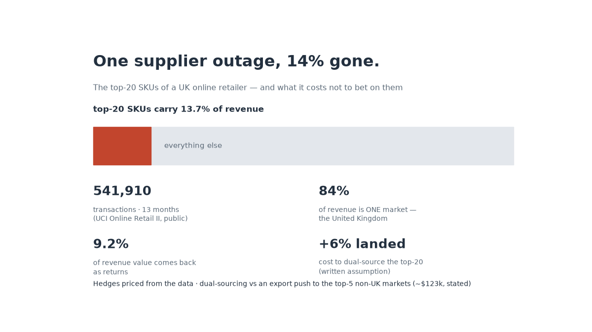

# Retail supply chain: concentration, returns, and priced hedges



**Data:** UCI Online Retail II (public, CC-BY), sheet *Year 2010-2011* — 541,910
transactions, 19,960 orders, 4,372 customers, 13 active months. Downloaded and
unzipped by `src/00_download_data.py`.

## The numbers that matter

| read | value |
|---|---|
| top-20 SKUs share of revenue | **13.7%** (of ~3,900 SKUs) |
| revenue in one market (UK) | **84%** |
| revenue value returning as returns | **9.2%** (cancelled invoices 1.7% separate) |
| average order value | **~$534** |
| multi-country orders | 15.4% |


## What I did with them

1. `src/01_analysis.py` — concentration curve, market split, order value bands,
   monthly pipeline (the pre-holiday surge shows up like clockwork), invoice-level
   rollback with counts reported for dropped rows.
2. `src/02_risk_scenarios.py` — two hedges priced, not vibes:
   - **A: dual-source the top-20 SKUs** → +6% landed cost (stated), against the
     single-supplier outage exposure.
   - **B: export push** into the top-5 non-UK markets at a 25% growth factor →
     ~$123k incremental revenue (stated).
3. `src/03_ai_insights.py` — narrated brief for a supply chain director, verified
   metrics only.
4. `src/04_dashboard.py` — `dashboard/index.html`, single file, PDF export.

## Ask it things

```bash
.venv/bin/python src/06_chat.py "sku concentration"
.venv/bin/python src/06_chat.py                    # REPL
.venv/bin/python src/06_chat.py "revenue by country"
```

Sample real answers: *sku concentration* → top-20 = 14.2% with the biggest single
line item named; *scenario* → dual-sourcing hedge ≈ $2,979/yr per stated costs vs
the outage exposure. The chat recomputes everything at question time, with or
without an LLM key (`GROQ_API_KEY` → narration only; offline → same numbers,
deterministic engine).


## Gaps worth stating

2009–2011 data. No supplier-lead-time fields exist in this dataset, so hedge
economics are demand-side only — a real rollout joins supplier master data first.
Returns are counted by revenue value, not units.

## Reproduce

```bash
python src/00_download_data.py && python src/01_analysis.py
python src/02_risk_scenarios.py && python src/03_ai_insights.py && python src/04_dashboard.py
```
